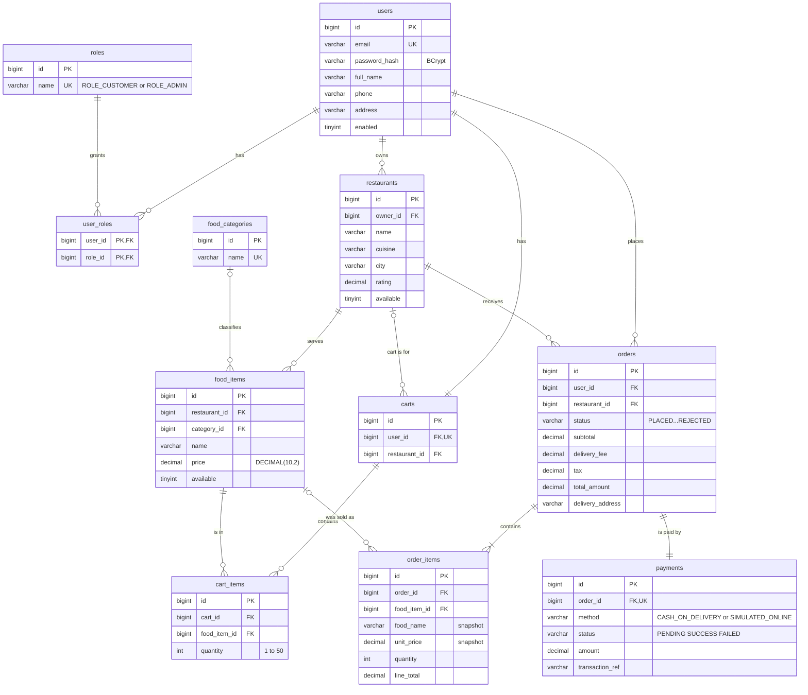

# FoodHub database: ER diagram

Rendered automatically by GitHub (Mermaid). The real, executable schema is
`backend/src/main/resources/db/migration/V1__create_schema.sql`.

## Design decisions worth explaining in an interview

| Decision | Why |
|---|---|
| `DECIMAL(10,2)` for money | Floating-point types cannot represent 0.10 exactly; money needs exact arithmetic. |
| `order_items` stores `food_name` and `unit_price` | A snapshot: changing a menu price later must not rewrite old orders. |
| `order_items.food_item_id` is `ON DELETE SET NULL` | Deleting a menu item keeps the order history readable. |
| `orders.restaurant_id` has no cascade | A restaurant with orders cannot be deleted (the API returns 409; hide it instead). |
| `payments.order_id` is unique | Exactly one payment record per order. |
| `carts.user_id` is unique | One server-side cart per user; it follows the user between devices. |
| `CHECK` constraints on status, price, quantity | The database refuses invalid data even if a bug slips past the application. |
| Indexes on `email`, `owner_id`, `restaurant_id`, `status`, `created_at` | Fast login, admin lists, and order filtering. |
| Flyway `V1`, `V2`, `V3` migrations | Schema changes are versioned and repeatable, never edited by hand in production. |
